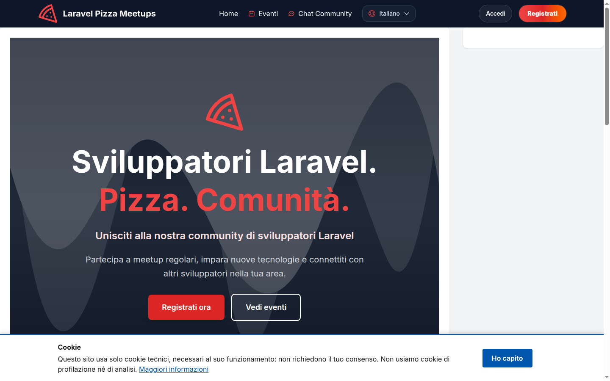

> Screenshot reali del front office. Il manuale completo per attori (visitatore,
> partecipante, organizzatore, amministratore), con riquadri numerati e PDF, vive
> già in [`../manuale-utente/readme.md`](../manuale-utente/readme.md) — non si
> duplica qui.

# Tema Meetup — indice manuals

## Scopo

Tema pubblico `pub_theme` del tenant: pagine Folio/Volt, auth, eventi, profilo.
Questa cartella `docs/manuals` è il contratto uniforme richiesto a ogni
modulo/tema; il contenuto operativo dettagliato resta in `docs/manuale-utente/`.

## Dove leggere i flussi

| Attore | Capitolo con screenshot reali |
|---|---|
| Visitatore | [01-visitatore.md](../manuale-utente/01-visitatore.md) |
| Partecipante | [02-partecipante.md](../manuale-utente/02-partecipante.md) |
| Organizzatore | [03-organizzatore.md](../manuale-utente/03-organizzatore.md) |
| Amministratore | [04-amministratore.md](../manuale-utente/04-amministratore.md) |

PDF: [manuale-completo.pdf](../manuale-utente/pdf/manuale-completo.pdf).

## Cattura screenshot

Script verificati: `docs/manuale-utente/tools/capture.cjs` (Playwright, dati demo).

## Limiti

- Non inventare UI non presenti in `manuale-utente/img/`.
- Admin Filament del tema/modulo Meetup: vedi capitoli organizzatore/amministratore.
